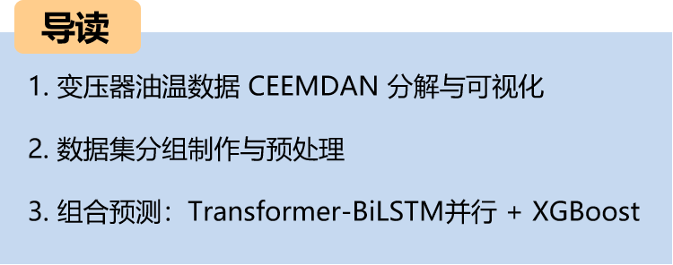
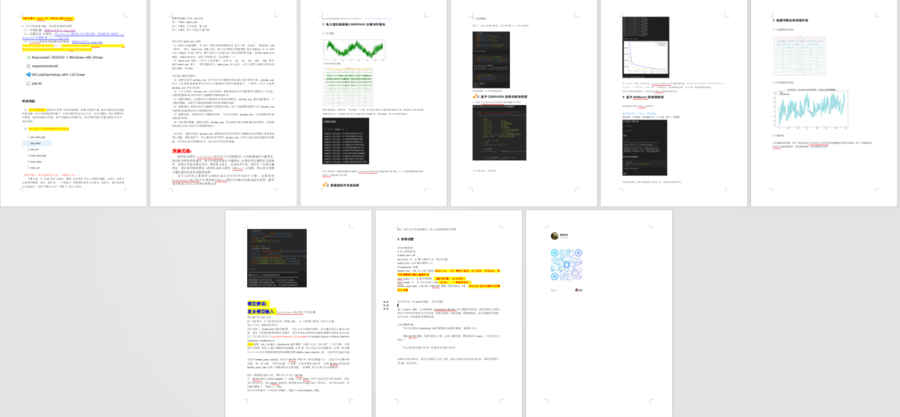
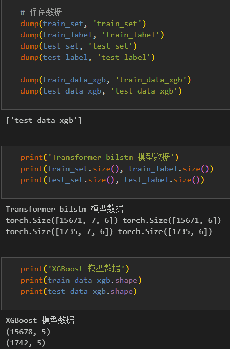
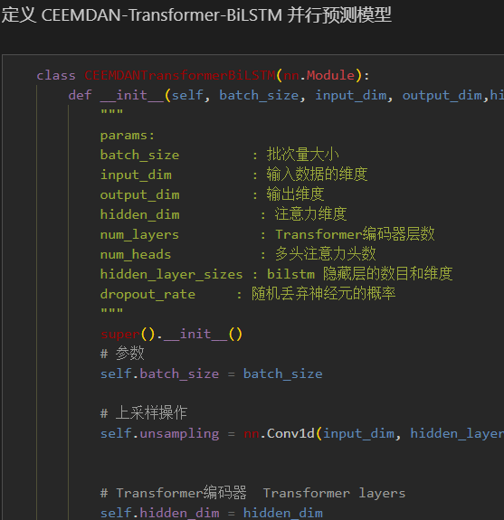
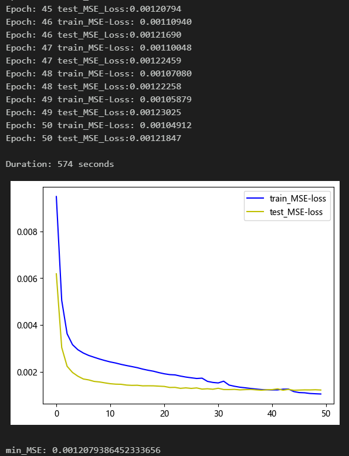
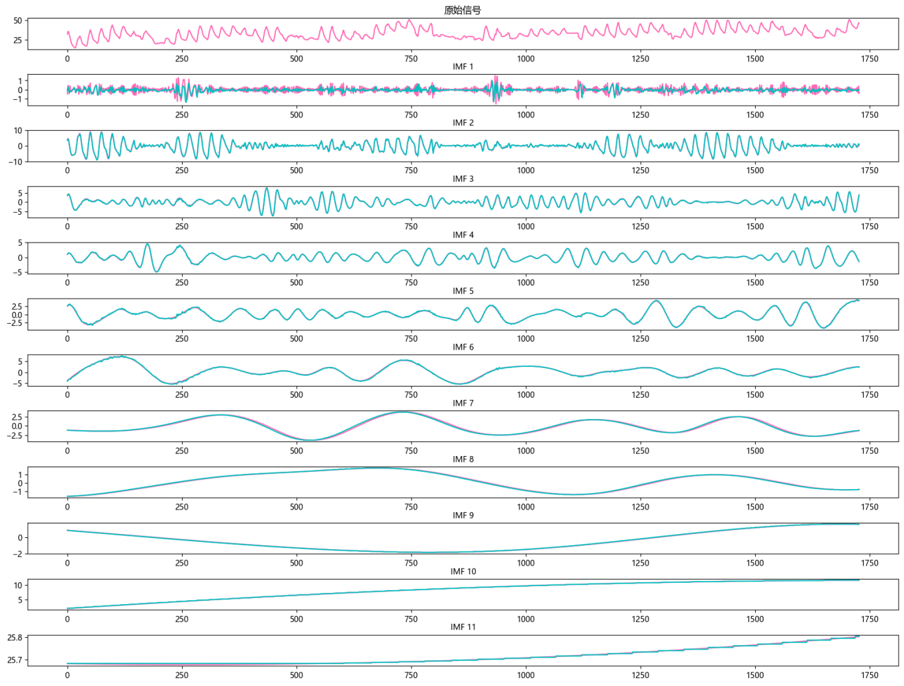
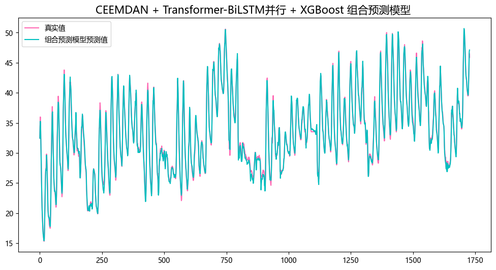
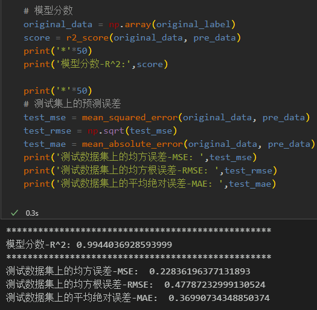
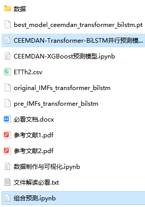

# CEEMDAN-Transformer-BiLSTM Parallel + XGBoost Combination Prediction

Combining Prediction Models:
1. Complex models are used to predict the component features of data, as they have a large parameter set and are suitable for predicting high-frequency complex feature components. However, low-frequency feature components are relatively simple. If complex models are still used, it may lead to overfitting and poor performance. Therefore, for low-frequency feature components, we use simple models (or machine learning models) to predict, followed by prediction component reconstruction to achieve high-precision prediction.
Environment: Python 3.9 PyTorch 1.8 or above
1. Transformer:
   A transformer is a deep learning model based on attention mechanisms widely used in natural language processing tasks. It captures the dependencies between different positions in an input sequence through self-attention mechanisms, thereby effectively modeling sequence data. In prediction tasks, transformers can help models capture complex correlations between time steps in the temporal signal.
2. BiLSTM:
   BiLSTM is a recurrent neural network with memory units and forgetting gates, capable of efficiently processing sequence data and capturing long-term dependencies within sequences. By considering both past and future information of the input sequence, BiLSTM can better understand the temporal characteristics and trends in the data.
3. Model Combination:
   An innovative model combining Transformer and BiLSTM leverages the advantages of both. The Transformer helps the model capture global sequence information and complex dependencies, while BiLSTM better captures local temporal features and trend changes. By combining these two models, the innovative model can achieve better performance and results in prediction tasks, improving prediction accuracy and efficiency.
4. Combining Predictions
The components decomposed by the CEEMDAN algorithm are divided into two parts through sample entropy calculation, and then combined prediction is realized by using the parallel model of transformer-BiLSTM and XGBoost.
\tNote: For this product, we also provide a model explanation and parameter adjustment guidance!
Preface
This paper introduces a method for comprehensive application of the Complete Ensemble Empirical Mode Decomposition (CEEMDAN) and the Transformer-BiLSTM parallel + XGBoost model to improve the predictive performance of time series data. The core of this method is the use of the CEEMDAN algorithm to decompose the time series, followed by the use of the Transformer-BiLSTM parallel model and the XGBoost model to model the decomposed data, and finally, the integration of both models' predictive results.
The detailed introduction to the power transformer dataset can be found in the following text:
Introduction to the Power Transformer Dataset and Preprocessing
1. Data Decomposition and Visualization of CEEMDAN for Power Transformers
1.1 Import data
1.2 CEEMDAN Decomposition
Based on the decomposition results, CEEMDAN has been divided into a total of 11 components. Subsequently, the sample entropy values for each component were calculated to analyze. Sample entropy is a method used to measure the complexity of sequences, which can be evaluated by calculating the uncertainty within the sequence. The higher the sample entropy, the greater the complexity of the sequence.
We roughly use the first six high-sample entropy complex components as the input for the Transformer-BiLSTM parallel model for prediction, and the last five low-sample entropy simple components as the input for the XGBoost model for prediction.
2. Data Set Creation and Preprocessing
2.1 Dataset division
Training set and test set are divided into 9:1 ratio, then further divided into 6:5 ratio for component data.
Batch save data for different models' predictions
3. Combination prediction model based on CEEMDAN
\t3.1 Define the Transformer-BiLSTM parallel prediction network model
\t3.2 Set parameters and train the model
\t50 epochs, MSE is 0.001208, the Transformer-BiLSTM parallel prediction effect is significant, the model can fully extract the temporal feature and spatial feature of time series, converges quickly, has excellent performance, high prediction accuracy, appropriately adjusting model parameters can further improve the model prediction performance.
\tNote: Adjust parameters:
\tIncrease the number of layers in the Transformer encoder and each layer's dimension, fine-tune learning rate;
\tAdjust the number of BiLSTM layers, neurons per layer, attention dimensions, increase more epochs (note to prevent overfitting)
\tChange the sliding window length (set a suitable window length)
\tSave training results and prediction data to be combined with the results of the later XGBoost model.
4. Model prediction based on XGBoost
\tTraditional machine learning model XGBoost tutorial:
\tSuperior predictive algorithm: XGBoost prediction model
\tData loading, training data and test data grouped into 5 components, divided into 5 datasets
\t
\tSave predicted data, other components' prediction is consistent with the above process, just keep the final model result.
5. Results visualization and model evaluation
\t5.1 Visualization of component prediction results
\t5.2 Visualization of combined prediction results
\t5.3 Model evaluation
\tFrom the component prediction results, it can be seen that the first 6 complex components are well fitted under the Transformer-BiLSTM parallel prediction model, while the last 5 simple components are very well fitted under the XGBoost model's prediction, the combined prediction effect is significant!
-  
Previously excellent content:  
Time series forecasting: Analysis and comparison of LSTM, ARIMA, Holt-Winters, SARIMA models  
Wind speed prediction (I) - Data set introduction and preprocessing  
Wind speed prediction (II) - EMD-LSTM model based on Pytorch  
Wind speed prediction (III) - EMD-LSTM-Attention model  
Wind speed prediction (IV) - EMD-Transformer model based on Pytorch  
Wind speed prediction (V) - EMD-CNN-LSTM model based on Pytorch  
Wind speed prediction (VI) - EMD-CNN-GRU parallel model based on Pytorch  
CEEMDAN + combined prediction model (BiLSTM-Attention + ARIMA)  
CEEMDAN + combined prediction model (CNN-LSTM + ARIMA)  
CEEMDAN + combined prediction model (Transformer - BiLSTM + ARIMA)  
CEEMDAN + combined prediction model (CNN-Transformer + ARIMA)  
Multi-feature variable sequence prediction (I) - CNN-LSTM wind speed prediction model  
Multi-feature variable sequence prediction (II) - CNN-LSTM-Attention wind speed prediction model  
Multi-feature variable sequence prediction (III) - CNN-Transformer wind speed prediction model  
Multi-feature variable sequence prediction (IV) - Transformer-BiLSTM wind speed prediction model  
Multi-feature variable sequence prediction (V) - CEEMDAN+CNN-LSTM wind speed prediction model  
Multi-feature variable sequence prediction (VI) - CEEMDAN+CNN-Transformer wind speed prediction model  
Prediction model based on SSA optimized by Sparrow Optimization Algorithm (SSA) for CEEMDAN-BiLSTM-Attention
CEEMDAN-Transformer-BiGRU Prediction Model Based on the Optimized Algorithm of Sparrows
Superior Prediction Model: Secondary Decomposition-Combination Prediction
Multi-feature variable sequence prediction (Part 7) CEEMDAN+Transformer-BiLSTM Prediction Model
Multi-feature variable sequence prediction (Part 8) CEEMDAN-SSA-BiLSTM Prediction Model Based on the Optimized Algorithm of Sparrows
Multi-feature variable sequence prediction (Part 11) Prediction Model Based on Pytorch's TCN-GRU
VMD + CEEMDAN Secondary Decomposition, CNN-LSTM Prediction Model
VMD + CEEMDAN Secondary Decomposition, CNN-Transformer Prediction Model
VMD + CEEMDAN Secondary Decomposition, Transformer-BiGRU Prediction Model
Prediction Model Based on the Optimized Algorithm of Sparrows - Code All-in-One Kit
Superior Combination Prediction Model!
High Innovation | CEEMDAN + SSA-TCN-BiLSTM-Attention Prediction Model
Superior Combination Prediction Model!
Lowest Price Online | Continuous Updates for the All-in-One Kit!
Based on TCN-SENet + BiGRU-GlobalAttention Parallel Prediction Model
Secondary Decomposition - Innovative Model Prediction All-in-One Kit
BiTCN-BiGRU-CrossAttention Fusion Spatiotemporal Features High Innovation Prediction Model
Update to Combination Prediction | Superior Combination Prediction Model!
Spatiotemporal Feature Fusion BiTCN-Transformer Parallel Prediction Model
Based on Multi-level Attention Mechanism Parallel Prediction Model
CEEMDAN-CNN-GRU-GlobalAttention + XGBoost Combination Prediction
Multi-step Prediction Series | LSTM, CNN, Transformer, TCN, Serial, Parallel Model Collection
END
\t2. Friends who like this can click to follow, give the article a "like" and share on social media or discuss in groups.

## Images

<!-- PAYMENT_BLOCK -->

## Get this dataset

- Payment link (Stripe): [Buy now](https://buy.stripe.com/3cs8yP7sY87d0vu9AB)
- Payment QR code: 

<!-- /PAYMENT_BLOCK -->
